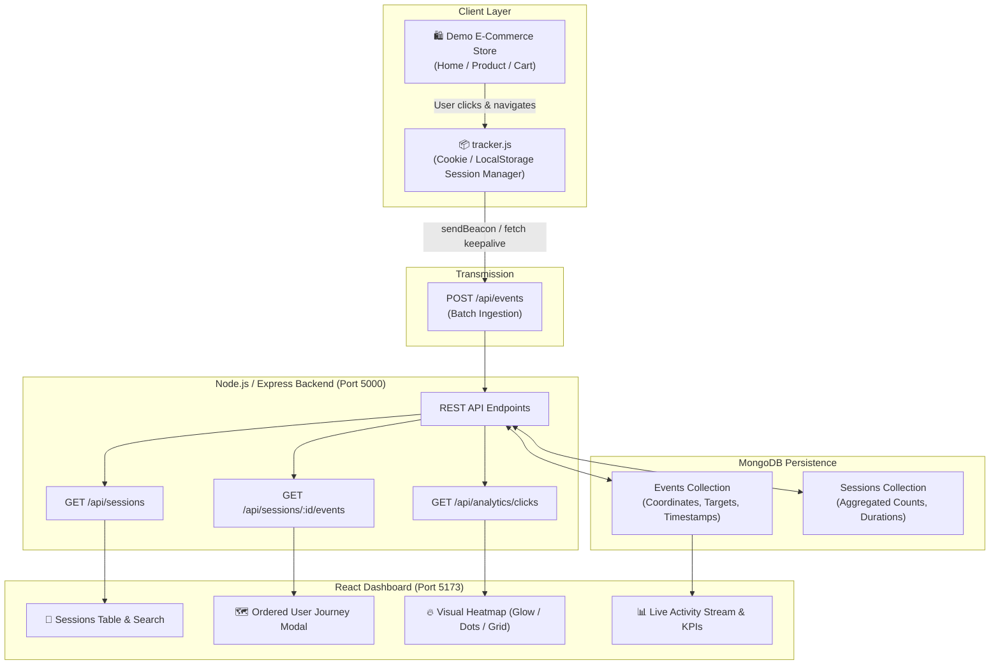

# CausalFunnel User Analytics & Heatmap Platform

A full-stack user interaction tracking, session journey analytics, and visual heatmap dashboard built for **CausalFunnel**.

---

## 🎯 Architecture & Workflow



---

## ✨ Features

### 1. Client-Side Interaction Tracker (`tracker/tracker.js`)
- **Zero-Dependency & Embeddable**: Lightweight pure JavaScript IIFE script embeddable on any website.
- **Session Lifecycle Management**:
  - Automatically identifies or generates a unique session ID.
  - Persists across pages using `localStorage` with resilient `document.cookie` fallback.
  - Handles 30-minute idle session timeout.
- **Automatic Event Tracking**:
  - `page_view`: Captures initial document load and Single Page Application (SPA) route changes via History API hooks (`pushState`, `replaceState`, `popstate`).
  - `click`: Captures exact `(x, y)` document coordinates, `(clientX, clientY)` viewport coordinates, and clicked DOM element metadata (tag name, ID, class, inner text snippet, href).
  - Screen and viewport resolutions (`innerWidth`, `innerHeight`, scroll offsets) for accurate multi-device normalization.
- **Resilient Transport**:
  - Dispatches via `navigator.sendBeacon` for zero event loss upon navigation or tab closing.
  - Seamless fallback to `fetch` with `keepalive: true`.
  - Micro-batching buffer to reduce network requests during rapid interaction bursts.

### 2. AuraStore - Demo E-Commerce Experience (`demo-site/`)
- A modern e-commerce storefront with three interactive pages:
  - `index.html`: Storefront homepage with hero banner, category filter chips, search bar, and product catalog cards.
  - `product.html`: Product detail page with dynamic image switcher, color finishes, quantity controls, and specification table.
  - `cart.html`: Shopping cart with coupon code application and order checkout tracking (`conversion_purchase`).
- Features a floating **Live Tracking Badge** displaying the active session ID with a direct shortcut to the analytics dashboard.

### 3. Backend REST APIs (`backend/`)
- Built with **Node.js** and **Express**.
- **APIs Implemented**:
  - `POST /api/events`: Ingests single or batch interaction payloads, validates required fields, inserts events, and atomically updates session summaries.
  - `GET /api/sessions`: Returns paginated list of sessions with total events, clicks, page views, duration, entry/exit paths, and user agent info.
  - `GET /api/sessions/:sessionId/events`: Fetches all events for a session in sequential order (ordered user journey) with time deltas between actions.
  - `GET /api/analytics/clicks?url=...`: Retrieves click coordinates, bounding boxes, and top-clicked elements for a specific page.
  - `GET /api/analytics/pages`: Lists unique tracked pages with their individual event and click counts.
  - `GET /api/analytics/overview`: Aggregated platform metrics (Total Sessions, Events, Clicks, Pageviews, Avg Duration, Recent activity stream).
  - `POST /api/seed`: Populates a realistic dataset of user journeys and click hotspots across the demo store.
  - `DELETE /api/analytics/reset`: Cleans database for fresh testing.
  - `GET /tracker.js`: Serves the embeddable tracker script with permissive CORS headers.
  - `GET /demo/*`: Serves the demo storefront.

### 4. Database Layer (MongoDB)
- Structured schemas using **Mongoose**:
  - **`Event` Model**: `sessionId`, `eventType`, `pageUrl`, `timestamp`, `x`, `y`, `clientX`, `clientY`, `viewport`, `target`, `metadata`. Indexed on `sessionId`, `eventType`, `pageUrl`, and `timestamp`.
  - **`Session` Model**: `sessionId`, `eventCount`, `pageViewCount`, `clickCount`, `firstSeen`, `lastSeen`, `durationSeconds`, `entryPage`, `exitPage`, `userAgent`.
- **Zero-Setup Database Fallback**:
  - If a `MONGODB_URI` is supplied (local mongod or MongoDB Atlas), it connects directly.
  - If no local MongoDB service is running, it automatically boots an **in-memory MongoDB server** (`mongodb-memory-server`) on launch, enabling instant testing without manual MongoDB database configuration.

### 5. Interactive Frontend Dashboard (`frontend/`)
- Built with **React 18**, **Vite**, and a **Dark Obsidian Design System**.
- **Overview Tab**:
  - KPI summary metric cards (Sessions, Ingested Events, Clicks, Page Views, Avg Session Duration).
  - Real-time live ingestion stream with target element inspection and animated pulse status.
- **Sessions View**:
  - Real-time session table with session ID search, quick filters ("Multi-page", "High Activity (10+)", "With Clicks"), event counts, and platform badges.
  - Clicking any session opens the **User Journey Modal**:
    - Chronological timeline with step numbers (`STEP #1`, `STEP #2`).
    - Event type badges (`page_view`, `click`, `conversion`).
    - Time elapsed indicator between steps (`+2.4s`).
    - Click coordinate chip: `X: 260px, Y: 780px`.
    - Clicked DOM target metadata: `BUTTON "+ Add to Cart" #btn-add-pro-x`.
- **Heatmap View**:
  - Dropdown selector for tracked page URLs.
  - **Three Visualization Modes**:
    1. **Heat Glow Mode**: HTML5 Canvas rendering radial Gaussian blur with thermal multi-color gradient (blue → cyan → yellow → red hotspots).
    2. **Exact Dots Mode**: Interactive coordinate dots with hover tooltips displaying element tags, text, and exact pixels.
    3. **Density Grid Mode**: Spatial density grid dividing the page layout into coordinate quadrants with click percentages.
  - Underlying page context preview: Renders the actual storefront page underneath the heatmap canvas to visualize exactly which buttons users clicked!
  - Top Clicked Elements breakdown widget showing top 5 interaction targets.
- **Live Demo Store Tab**:
  - Interactive sandbox embedded right inside the dashboard to browse the store, click items, and see events appear dynamically.

---

## 🛠️ Tech Stack

| Layer | Technologies |
|---|---|
| **Client Tracker** | Vanilla JavaScript (ES6+), `localStorage`, `Document.cookie`, `navigator.sendBeacon`, HTML5 History API |
| **Demo Store** | Semantic HTML5, Vanilla CSS3, Responsive Design |
| **Backend** | Node.js (v24), Express.js (v4), Mongoose (v8), CORS, Morgan |
| **Database** | MongoDB (with automatic `mongodb-memory-server` fallback) |
| **Frontend Dashboard** | React 18, Vite 5, Lucide React Icons, Canvas API, CSS Variables Design System |

---

## 🚀 Setup & Running Instructions

### Prerequisites
- [Node.js](https://nodejs.org/) (v18 or higher recommended; developed and tested on Node v24)
- npm (v9+)

### 1. Installation
Clone the repository and install dependencies for both backend and frontend:

```bash
# Clone the repository
git clone <repository-url>
cd <repository-directory>

# Install dependencies
npm run install:all
```
*(Or install individually: `cd backend && npm install` then `cd ../frontend && npm install`)*

---

### 2. Starting the Application

You can start the backend and frontend separately or concurrently:

#### Option A: Run Backend Server (Port 5000)
```bash
# From the root directory:
npm run server
```
> The backend will automatically start. If no MongoDB URI is set in `.env`, an in-memory MongoDB instance will automatically initialize and seed realistic demo analytics.

#### Option B: Run Frontend Dashboard (Port 5173)
```bash
# In a second terminal:
npm run client
```

Now open:
- **Analytics Dashboard**: [http://localhost:5173](http://localhost:5173)
- **Demo Storefront**: [http://localhost:5000/demo/index.html](http://localhost:5000/demo/index.html)
- **Backend API Health**: [http://localhost:5000/api/health](http://localhost:5000/api/health)
- **Standalone Tracker Script**: [http://localhost:5000/tracker.js](http://localhost:5000/tracker.js)

---

### 3. Optional Environment Variables (`backend/.env`)
Create a `.env` file in the `backend/` directory if you wish to connect to an external MongoDB database:

```env
PORT=5000
# Optional: Set your local MongoDB or MongoDB Atlas URI
MONGODB_URI=mongodb://localhost:27017/causalfunnel_analytics
```
*Note: If `MONGODB_URI` is omitted, the app will run seamlessly using an automated in-memory MongoDB database.*

---

## 🧪 Testing the Live Tracking Pipeline

1. Open the dashboard at [http://localhost:5173](http://localhost:5173).
2. Click the **"Live Demo Store"** tab (or open [http://localhost:5000/demo/index.html](http://localhost:5000/demo/index.html) in a new window).
3. Click on the "+ Add to Cart" buttons, the hero CTA, change colors, or navigate between pages.
4. Switch back to the **Sessions** tab to see your active session with updated event counts, or open the **Heatmap** tab to see your new click hotspots rendered in real time!
5. You can also click the **"Seed Demo"** button in the dashboard navbar anytime to repopulate realistic e-commerce traffic.

---

## ⚖️ Assumptions & Architectural Trade-offs

1. **Dual Storage Strategy (Events vs. Sessions)**:
   - *Design*: We store every raw interaction in an `events` collection while maintaining a lightweight summary record in a `sessions` collection.
   - *Trade-off*: Writing an event performs an update on the session document. This small write overhead eliminates the need for expensive multi-gigabyte aggregation pipelines when listing sessions on high-traffic dashboards, allowing `GET /api/sessions` to respond in sub-millisecond time.
   - *Fallback*: If a session record is missing, an aggregation pipeline over the raw events automatically computes session totals on the fly.

2. **Coordinate Systems & Heatmap Normalization**:
   - *Design*: The tracker records both document-relative coordinates (`pageX`, `pageY` incorporating scroll offset) and viewport-relative coordinates (`clientX`, `clientY`), along with `viewport` width and height.
   - *Trade-off*: Heatmaps on responsive websites can shift when users browse on different screen widths. By storing both coordinates and viewport dimensions alongside the clicked DOM element metadata (`target.tagName`, `target.id`, `target.text`), the system can accurately map clicks to elements even if the layout reflows.

3. **Transmission Resilience (`navigator.sendBeacon` vs `fetch`)**:
   - *Design*: The client tracker prioritizes `navigator.sendBeacon` and falls back to `fetch` with `keepalive: true`.
   - *Trade-off*: When users click an outgoing link or close the browser tab, standard AJAX requests are often aborted before completing. `sendBeacon` guarantees browser delivery asynchronously during page unload without blocking navigation.

4. **In-Memory MongoDB Fallback**:
   - *Design*: Included `mongodb-memory-server` as an automatic fallback when no external MongoDB connection is provided.
   - *Trade-off*: Ensures zero setup friction for evaluators while maintaining full compatibility with production MongoDB Atlas clusters via `MONGODB_URI`.
