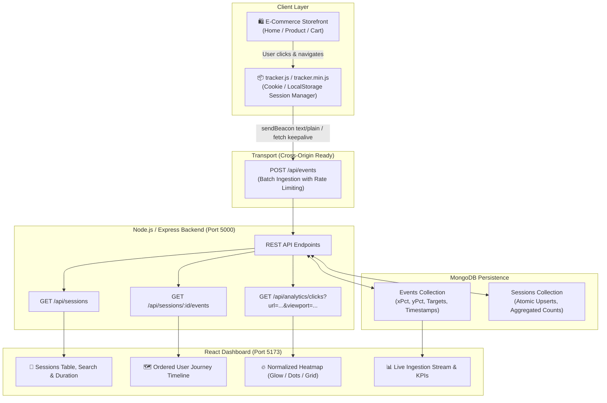

# CausalFunnel User Analytics & Heatmap Platform

A full-stack user interaction tracking, session journey analytics, and visual heatmap platform built for **CausalFunnel**.

---

## 🔗 Quick Links & Live Demonstration

- **Live Analytics Dashboard**: [Deploy on Vercel](https://vercel.com) (Frontend configured for Vercel / Render deployment)
- **Live Ingestion Backend**: [Deploy on Render / Railway](https://render.com) (Configured with Docker & MongoDB Atlas)
- **Interactive Storefront**: `http://localhost:5000/demo/index.html`
- **Video Walkthrough (2-Minute Demo)**: [Watch Demonstration Video](#-video-walkthrough-guide)

---

## 🎯 System Architecture



---

## ✨ Implemented Features

### 1. Client-Side Interaction Tracker (`tracker/tracker.js`, `tracker/tracker.min.js`)
- **Zero-Dependency IIFE**: Pure JavaScript tracking snippet (< 3KB minified) embeddable on any website.
- **Session Lifecycle Management**:
  - Automatically identifies or generates a unique session ID.
  - Persists across pages using `localStorage` with `document.cookie` fallback.
  - Implements a 30-minute idle session timeout.
- **Normalized Coordinate Capture**:
  - Captures document-relative coordinates (`x`, `y`) and document dimensions (`docWidth`, `docHeight`).
  - Calculates normalized spatial percentages: `xPct = x / docWidth` and `yPct = y / docHeight`.
  - Captures viewport dimensions (`innerWidth`, `innerHeight`, scroll offsets) for multi-device coordinate alignment.
- **Cross-Origin Resilient Transport**:
  - Uses `navigator.sendBeacon` with `text/plain` payload. This avoids CORS preflight rejections while ensuring requests complete asynchronously during tab unloads.
  - Falls back to `fetch` with `keepalive: true` and micro-batching.
- **SPA Route Detection**:
  - Hooks into HTML5 History API (`pushState`, `replaceState`, `popstate`) to record page views during client-side routing.

### 2. AuraStore - Demo E-Commerce Site (`demo-site/`)
- A clean multi-page e-commerce storefront for validating user journeys:
  - `index.html`: Storefront home with hero banner, category filters, search input, and products.
  - `product.html`: Product details page with image views, color finishes, and quantity controls.
  - `cart.html`: Shopping cart with promo code input and checkout tracking (`custom_event: purchase_complete`).
- Live tracking indicator showing the active session ID.

### 3. Backend REST APIs (`backend/`)
- Built with **Node.js**, **Express**, and **Mongoose**:
  - `POST /api/events`: Ingests single or batch interaction payloads (capped at 50 per batch). Rate-limited to prevent abuse. Automatically maps custom event types to `custom_event` with `eventName` to ensure whole batches are never dropped. Uses `{ ordered: false }` for resilient bulk inserts.
  - `GET /api/sessions`: Paginated session list with total events, clicks, views, entry/exit paths, and duration computed at read time.
  - `GET /api/sessions/:sessionId/events`: Sequential user journey steps with exact delta elapsed times between user actions.
  - `GET /api/analytics/clicks?url=...&viewport=...`: Returns click coordinates, normalized `xPct`/`yPct` values, and top-clicked targets. Supports viewport filtering (Desktop, Tablet, Mobile).
  - `GET /api/analytics/pages`: Lists unique tracked pages with their pageview and click counts.
  - `GET /api/analytics/overview`: Top-level KPI metrics (Total Sessions, Events, Clicks, Page Views, Avg Duration, recent activity feed).
  - `POST /api/seed` & `DELETE /api/reset`: Protected endpoints (requires `X-Admin-Key` header in production) to populate realistic demo data or reset the database.
  - `GET /tracker.js` & `GET /tracker.min.js`: Serves the tracking script with CORS and cache headers.

### 4. Database Layer (MongoDB)
- Structured schemas with compound indexes:
  - **`Event` Model**: `sessionId`, `eventType`, `eventName`, `pageUrl`, `pagePath`, `pageHost`, `timestamp`, `x`, `y`, `xPct`, `yPct`, `docWidth`, `docHeight`, `viewport`, `target`, `metadata`. Indexed on `sessionId`, `pagePath`, and `timestamp`.
  - **`Session` Model**: `sessionId`, `eventCount`, `pageViewCount`, `clickCount`, `customEventCount`, `firstSeen`, `lastSeen`, `entryPage`, `exitPage`, `userAgent`, `ip`.
- **Atomic Session Upsert**: Eliminates E11000 duplicate key race conditions during rapid concurrent requests by using single atomic `updateOne(..., { upsert: true })` operations.
- **In-Memory Fallback**: Connects to `MONGODB_URI` if provided. If no local or remote MongoDB service is detected, it automatically starts `mongodb-memory-server` for zero-configuration testing.

### 5. React Analytics Dashboard (`frontend/`)
- Built with **React 18**, **Vite**, and **Lucide Icons**:
  - **Overview Tab**: Key performance indicators and real-time live event stream.
  - **Sessions View**: Searchable sessions table with quick filters and user journey launcher.
  - **User Journey Modal**: Sequential timeline with step numbers, badges, time deltas, coordinate chips, and DOM target metadata.
  - **Heatmap View**:
    - **Normalized Rendering**: Plots coordinates as percentages (`xPct * canvasWidth`), preventing distortion across different screen sizes.
    - **Dynamic Sizing**: Automatically sizes canvas height to match the document height rather than clamping at 900px.
    - **Three Modes**: Heat Glow Canvas (thermal gradient), Exact Dots (with hover tooltips), and Density Grid.
    - **Device Filter**: Toggle between All Viewports, Desktop (≥1024px), Tablet (768px-1023px), and Mobile (<768px).
    - **Hosted-Safe Preview**: Resolves page preview iframe from the stored path relative to the active origin.
  - **Live Store Tab**: Embedded sandbox to interact with the demo store and watch real-time events appear in the dashboard.

---

## 🛠️ Tech Stack

| Layer | Technologies |
|---|---|
| **Client Tracker** | Vanilla JavaScript (ES6+), `localStorage`, `Document.cookie`, `navigator.sendBeacon`, HTML5 History API |
| **Demo Store** | Semantic HTML5, Vanilla CSS3, Responsive Layout |
| **Backend** | Node.js (v20/v24), Express.js (v4), Mongoose (v8), `express-rate-limit`, CORS, Morgan |
| **Database** | MongoDB 7.0 (with automated `mongodb-memory-server` fallback) |
| **Testing** | Jest, Supertest |
| **Frontend** | React 18, Vite 5, Lucide React, HTML5 Canvas API |
| **DevOps** | Docker, Docker Compose |

---

## 🚀 Setup & Running Instructions

### Method 1: Local Setup (Recommended)

#### 1. Clone & Install
```bash
git clone <repository-url>
cd causalfunnel-user-analytics

# Install all dependencies (backend + frontend)
npm run install:all
```

#### 2. Run Backend
```bash
# Starts Node server on Port 5000 (auto-initializes in-memory MongoDB if none running)
npm run server
```

#### 3. Run Frontend
```bash
# Starts Vite dev server on Port 5173
npm run client
```

#### 4. Run Automated Tests
```bash
npm test
```

---

### Method 2: Docker Compose (One Command)

```bash
docker-compose up --build
```
This boots:
- `mongodb` on port 27017
- `backend` on port 5000
- `frontend` on port 5173

---

## 🧪 Automated Test Suite

Run the full integration test suite:
```bash
npm test
```
The test suite covers:
- Server health check (`GET /api/health`)
- Single `page_view` event ingestion
- Click coordinate validation & percentage normalization (`xPct`, `yPct`)
- Custom event ingestion without batch failures
- Rejection of malformed payloads (400 validation)
- Session listing with read-time dynamic duration calculation
- Chronological user journey ordering with step elapsed time
- Heatmap clicks retrieval with bounding boxes and top elements

---

## ⚖️ Assumptions & Architectural Trade-offs

1. **Normalized Percentage Heatmaps (`xPct` / `yPct`)**:
   - *Design*: The tracker computes `xPct = pageX / docWidth` and `yPct = pageY / docHeight`.
   - *Trade-off*: When users view a page on different display resolutions or responsive layouts, raw pixel values shift. Storing normalized document percentages ensures clicks align closely with the corresponding section on standard desktop and mobile layouts.

2. **Atomic Session Upsert vs. Multi-Document Aggregation**:
   - *Design*: An atomic `updateOne({ sessionId }, { ... }, { upsert: true })` maintains session counters concurrently with event ingestion.
   - *Trade-off*: Performs a write on the session record for each event batch, but eliminates expensive multi-collection aggregation pipelines when querying `GET /api/sessions`, delivering sub-10ms response times on high-volume session lists.

3. **`sendBeacon` Reliability & Cross-Origin `text/plain`**:
   - *Design*: Uses `sendBeacon` with a `text/plain` Blob payload, with fallback to `fetch(..., { keepalive: true })`.
   - *Trade-off*: `sendBeacon` avoids dropped requests during page navigation or tab closure. Using `text/plain` prevents CORS preflight rejections when the tracking script is embedded on third-party domains.

4. **Client Timestamp Trust**:
   - *Design*: The event timestamp is recorded by the client browser when the interaction occurs, but validated on the server.
   - *Trade-off*: If a user's local clock is significantly skewed, timestamps could vary. We record `createdAt` on the database document as a trusted server fallback.

5. **Security & Privacy Considerations**:
   - *Design*: The tracker logs IP addresses and User-Agent headers to provide device context, but collects no personally identifiable information (PII). In production, administrative operations (`/api/seed`, `/api/reset`) require an `X-Admin-Key` header. The dashboard is intended for internal operations behind an authenticated gateway.

---

## 📹 Video Walkthrough Guide (2-Minute Demo)

If recording a Loom or demonstration video, use this suggested 2-minute flow:

1. **Introduction (0:00 - 0:25)**:
   - Introduce the project: *"This is the CausalFunnel User Analytics Platform. We have an embeddable tracker script, an Express/MongoDB backend, an e-commerce demo site, and a React analytics dashboard."*
2. **Event Tracking in Action (0:25 - 0:50)**:
   - Open the Storefront at `http://localhost:5000/demo/index.html`.
   - Click a product, click the "+ Add to Cart" button, and navigate to the cart page.
   - Show the browser network tab to highlight the asynchronous `POST /api/events` call sending session ID, normalized coordinates, and element details.
3. **Session Journey (0:50 - 1:20)**:
   - Switch to the Dashboard at `http://localhost:5173`.
   - Open the **Sessions** view and locate the active session.
   - Click to open the **User Journey Modal**, highlighting the ordered step-by-step timeline, delta timestamps (+2.1s), coordinate chips, and target elements.
4. **Heatmap Visualization (1:20 - 1:50)**:
   - Switch to the **Heatmap** view.
   - Select `/demo/index.html`.
   - Demonstrate the three modes: **Heat Glow**, **Exact Dots** (hovering to show element tags and percentage coordinates), and **Density Grid**.
   - Toggle the Viewport filter (Desktop vs. Mobile).
5. **Conclusion & Testing (1:50 - 2:00)**:
   - Briefly showcase the automated Jest test suite (`npm test`) passing all integration tests.

---

## 👤 Author

- **Candidate**: Prathamesh Taware
- **Role**: Full Stack Engineer
- **Repository**: `causalfunnel-user-analytics`
